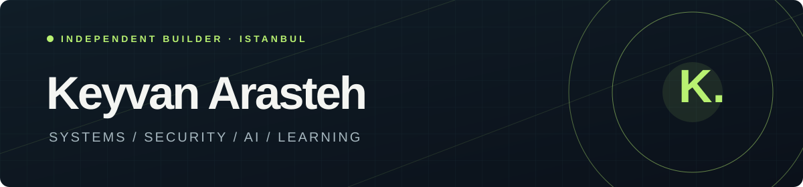
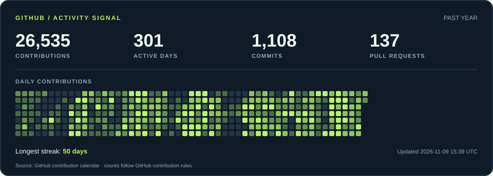

### Hi, I'm Keyvan.

Founder of **QLine Technology Solutions** · systems architect · security researcher · instructor in Istanbul.

I build open tools and practical learning spaces across **security**, **AI infrastructure**, and **developer experience**. I like systems that people can inspect, understand, and improve.

**Currently exploring** · memory-safe utilities · security analysis · multi-provider AI tooling

| Start here | What you'll find |
| --- | --- |
| [Portfolio](https://keyvanarasteh.github.io/) | Selected work, writing, and background |
| [Projects](https://keyvanarasteh.github.io/projects/) | Open-source tools and their source code |
| [Qrofessor Foundry](https://qrofessor.com/foundry) | Security courses, labs, and technical resources |

**Featured builds:** [qai-sdk](https://github.com/keyvanarasteh/qai-sdk) · [WebQ](https://github.com/keyvanarasteh/WebQ) · [Qleaner](https://github.com/keyvanarasteh/Qleaner) · [os-lab](https://github.com/keyvanarasteh/os-lab)

### GitHub activity · past year

Counts follow GitHub's contribution rules. The graphic shows its UTC update time and refreshes hourly.

**Connect:** [LinkedIn](https://www.linkedin.com/in/keyvanarasteh/) · [Qrofessor](https://qrofessor.com/) · [YouTube](https://www.youtube.com/@drvoidgate)

**Research:** [Google Scholar](https://scholar.google.com/citations?user=sTiM0yQAAAAJ&hl=en) · [ResearchGate](https://www.researchgate.net/profile/Keyvan-Arasteh) · [ORCID](https://orcid.org/0000-0002-2041-6439)

**Rust:** [crates.io](https://crates.io/users/keyvanarasteh)
